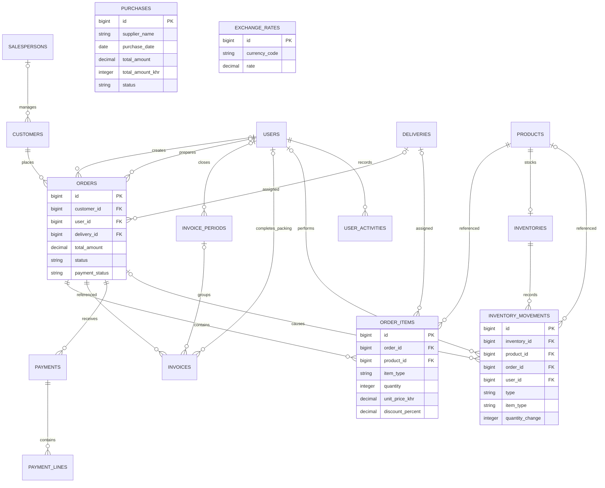
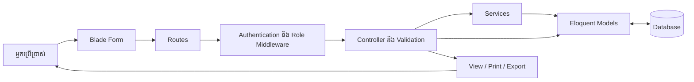
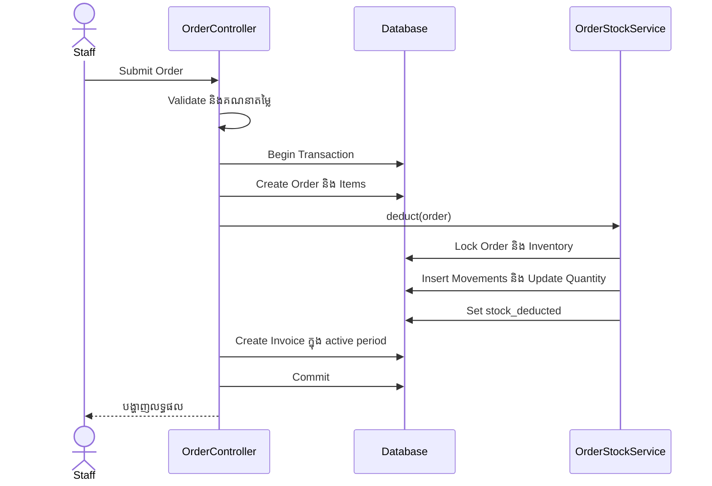

# ឯកសារប្រព័ន្ធ MY_PIZZA

កាលបរិច្ឆេទ៖ 11 វិច្ឆិកា 2026  
ប្រភេទ៖ ឯកសារពិពណ៌នាប្រព័ន្ធ និងសៀវភៅណែនាំអ្នកប្រើប្រាស់  
មូលដ្ឋាន៖ កូដ local ក្នុង project `my_pizza`។

ឯកសារនេះពិពណ៌នាមុខងារ និងរចនាសម្ព័ន្ធដែលបានឃើញក្នុង routes, controllers, services, models, views និង migrations។ មិនមែនជាលទ្ធផលត្រួតពិនិត្យ Database ឬការដំណើរការលើ hosting ពិតទេ។ បញ្ហាអាជីវកម្មក្នុងជំពូកទី ២ គឺជាបរិបទសម្រាប់ការសរសេររបាយការណ៍ ដែលម្ចាស់ប្រព័ន្ធគួរផ្ទៀងផ្ទាត់ជាមួយការងារជាក់ស្ដែង។

## មាតិកា

1. Introduction — សេចក្ដីផ្ដើម
2. Problem — បញ្ហា និងតម្រូវការ
3. Result — លទ្ធផល និងសមត្ថភាពប្រព័ន្ធ
4. Database Design — ការរចនាមូលដ្ឋានទិន្នន័យ
5. Schema និង Database Relationships
6. Code Analysis និង Data Flow
7. User Interface — ផ្ទាំងប្រើប្រាស់
8. How to Use — របៀបប្រើប្រាស់
9. ការផ្ទៀងផ្ទាត់ និងការកែលម្អបន្ត

## ១. Introduction — សេចក្ដីផ្ដើម

### ១.១ ទិដ្ឋភាពទូទៅ

MY_PIZZA ជា Web Application សម្រាប់គ្រប់គ្រងការលក់ផលិតផល ស្តុក អតិថិជន វិក្កយបត្រ ការវេចខ្ចប់ ការដឹកជញ្ជូន ការទទួលប្រាក់ និងចំណាយប្រចាំថ្ងៃ។ ប្រព័ន្ធផ្ដល់កន្លែងកណ្ដាលសម្រាប់បុគ្គលិកការិយាល័យ បុគ្គលិកស្តុក អ្នកគ្រប់គ្រង និងអ្នកត្រួតពិនិត្យ ប្រើទិន្នន័យពាក់ព័ន្ធគ្នា។

### ១.២ គោលបំណង

- រក្សាទុកទិន្នន័យការលក់ និងអតិថិជនឱ្យមានរចនាសម្ព័ន្ធច្បាស់លាស់។
- ភ្ជាប់ Order ជាមួយទំនិញ Invoice និងប្រាក់ទូទាត់។
- កាត់ និងសងស្តុកតាមប្រតិបត្តិការ ព្រមទាំងរក្សាប្រវត្តិចលនាស្តុក។
- គ្រប់គ្រងការវេចខ្ចប់ និងការដឹកជញ្ជូន។
- ស្វែងរកទិន្នន័យតាមតម្រង និងរៀបចំរបាយការណ៍សម្រាប់ការតាមដាន។
- បែងចែកសិទ្ធិប្រើប្រាស់តាមតួនាទី។

### ១.៣ វិសាលភាព

មុខងារមាន៖ Login/Profile, Users, Products, Inventory, Customers, Salespersons, Orders, Invoices, Packing, Deliveries, Payments, Purchases និង Reports។ មានផ្ទាំងទីតាំងអតិថិជន និង Driver Portal ផងដែរ។

Purchases ក្នុងប្រព័ន្ធនេះប្រើជាកំណត់ត្រាចំណាយ។ ការបង្កើត Purchase មិនបង្កើនស្តុកដោយស្វ័យប្រវត្តិទេ។ ប្រព័ន្ធមិនទាន់ត្រូវបានផ្ទៀងផ្ទាត់ថាជាប្រព័ន្ធគណនេយ្យពេញលេញដែលមាន General Ledger ឬ Double-entry Accounting ឡើយ។

### ១.៤ បច្ចេកវិទ្យា

| ផ្នែក | បច្ចេកវិទ្យាដែលកូដប្រកាសប្រើ |
|---|---|
| Backend | PHP `^8.2`, Laravel `^12.0` |
| Frontend | Laravel Blade, HTML, CSS និង JavaScript |
| Data Access | Eloquent ORM និង Query Builder |
| Database | Relational Database; កូដខ្លះប្រើ SQL សម្រាប់ MySQL/MariaDB |
| PDF | `barryvdh/laravel-dompdf` |
| Spreadsheet | `phpoffice/phpspreadsheet` |
| Testing | PHPUnit |

លេខ version ខាងលើជាតម្រូវការក្នុង `composer.json` មិនមែនការអះអាងពី version ដែលកំពុងដំណើរការលើ hosting ទេ។

## ២. Problem — បញ្ហា និងតម្រូវការ

### ២.១ បញ្ហាដែលប្រព័ន្ធមានគោលដៅដោះស្រាយ

ពេលគ្រប់គ្រងការលក់ និងស្តុកតាមកំណត់ត្រាដាច់ដោយឡែក ការតាមដានអាចជួបបញ្ហាដូចខាងក្រោម។ ចំណុចទាំងនេះជាការពិពណ៌នាបញ្ហាគោលដៅ មិនមែនទិន្នន័យពីការសម្ភាសន៍អ្នកប្រើប្រាស់ទេ។

| បញ្ហា | ផលប៉ះពាល់ | មុខងារឆ្លើយតប |
|---|---|---|
| ការកត់ត្រាលក់ និងស្តុកដាច់ពីគ្នា | ស្តុកមិនស្របតាមប្រតិបត្តិការ | OrderStockService និង Inventory Movements |
| មិនបែងចែកទំនិញលក់ និងថែម | ពិបាកពន្យល់ចំនួនស្តុកចេញ | `item_type`: sale/free |
| ពិបាកតាមដានអតិថិជនមិនទាន់បង់ | ពិបាកប្រមូលប្រាក់ | Payments និង Payment Status |
| ការវេចខ្ចប់មិនមានបញ្ជីត្រួតពិនិត្យ | អាចខកខានទំនិញ | Packing Checklist |
| ពិបាកតាមដានចំណាយប្រចាំថ្ងៃ | មិនឃើញចំណាយតាមពេលវេលា | Purchases និងតម្រងចន្លោះថ្ងៃ |
| ទិន្នន័យប្រមូលផ្ដុំយឺត | ពិបាកសម្រេចចិត្ត | Dashboard និង Reports |
| អ្នកប្រើមានភារកិច្ចខុសគ្នា | ត្រូវកំណត់ការចូលប្រើ | Authentication និង Role Middleware |

### ២.២ តម្រូវការមុខងារ

ប្រព័ន្ធត្រូវអាចបង្កើត/កែទិន្នន័យមេ បង្កើត Order និង Invoice គណនាទឹកប្រាក់ គ្រប់គ្រងស្តុក កត់ត្រាការទូទាត់ និងចំណាយ បោះពុម្ពឯកសារ និងបង្ហាញរបាយការណ៍។ មុខងារ Export មានតាម module ដែល routes បានកំណត់; Purchases មិនទាន់បានបន្ថែម Export ក្នុងការកែថ្មីនេះទេ។

### ២.៣ តម្រូវការគុណភាព

តម្រូវការសម្រាប់ការប្រើប្រាស់ពិតរួមមាន៖ ទិន្នន័យត្រឹមត្រូវ សិទ្ធិច្បាស់លាស់ UI ងាយយល់ ការរក្សាទុកប្រវត្តិ និងសមត្ថភាពស្ដារទិន្នន័យ។ ល្បឿន សមត្ថភាពទទួលអ្នកប្រើច្រើន និងការស្ដារ Backup ត្រូវវាស់វែងបន្ថែម មិនទាន់មានលទ្ធផលវាស់ក្នុងឯកសារនេះទេ។

## ៣. Result — លទ្ធផល និងសមត្ថភាពប្រព័ន្ធ

### ៣.១ លទ្ធផលដែលកូដអនុវត្ត

- Order រក្សាទុកជាមួយ Order Items ហើយបង្កើត Invoice ស្វ័យប្រវត្តិ។
- ស្តុកត្រូវកាត់ពេលបង្កើត Order និងកែតាមចំនួនខុសគ្នាពេលកែ Order។
- ប្រតិបត្តិការស្តុកមានបរិមាណមុន/ក្រោយ ប្រភេទប្រតិបត្តិការ និងអ្នកធ្វើ។
- អាចគ្រប់គ្រងទំនិញលក់ និងទំនិញថែមដោយឡែក។
- មានការបោះពុម្ព Invoice និងស្លាក Packing តាម template។
- អាចកត់ត្រាប្រាក់ទូទាត់ រួមទាំងព័ត៌មាន USD/KHR និង Payment Lines។
- មានចំណាយប្រចាំថ្ងៃ និងតម្រង «ចាប់ពី / រហូតដល់» ដែលកំណត់ថ្ងៃនេះជាលំនាំដើម។
- មានរបាយការណ៍ការលក់ ស្តុក អតិថិជន និងប្រចាំថ្ងៃតាមសិទ្ធិ។

### ៣.២ អត្ថប្រយោជន៍រំពឹងទុក

ការភ្ជាប់ទិន្នន័យអាចជួយបន្ថយការបញ្ចូលដដែលៗ ងាយតាមដានស្តុក និងងាយស្វែងរកប្រតិបត្តិការ។ មិនមានការវាស់មុន/ក្រោយសម្រាប់អះអាងជាភាគរយ ឬម៉ោងដែលបានសន្សំនៅឡើយទេ។

### ៣.៣ ព្រំដែនលទ្ធផល

ឯកសារនេះជាការវិភាគកូដ មិនមែនរបាយការណ៍ថាមុខងារទាំងអស់បានឆ្លងកាត់ UAT ឬការសាកល្បងលើ production ទេ។

## ៤. Database Design — ការរចនាមូលដ្ឋានទិន្នន័យ

### ៤.១ ក្រុមទិន្នន័យ

| ក្រុម | តារាង |
|---|---|
| អ្នកប្រើប្រាស់ | users, user_activities |
| ទិន្នន័យមេ | customers, salespersons, products, deliveries, exchange_rates |
| ប្រតិបត្តិការលក់ | orders, order_items, invoices, invoice_periods |
| ស្តុក | inventories, inventory_movements |
| ហិរញ្ញវត្ថុប្រតិបត្តិការ | payments, payment_lines, purchases |
| Laravel Infrastructure | sessions, password_reset_tokens, cache, cache_locks, jobs, job_batches, failed_jobs |

### ៤.២ គោលការណ៍រចនា

`id` ជា Primary Key។ Foreign Keys ភ្ជាប់ទិន្នន័យមេ និងប្រតិបត្តិការ។ `order_items` បំបែកបន្ទាត់ទំនិញពី Order ដើម្បីឱ្យ Order មួយមានទំនិញច្រើន។ `payment_lines` បំបែកព័ត៌មានការទទួលប្រាក់ពីកំណត់ត្រា Payment។ `inventory_movements` រក្សាប្រវត្តិ ខណៈ `inventories` រក្សាសមតុល្យស្តុកបច្ចុប្បន្ន។

ទិន្នន័យមួយចំនួនដូចជា total amount និង customer name ក្នុង payments ត្រូវបានរក្សាទុកម្ដងទៀត។ ដូច្នេះ schema មានទាំងការបែងចែកទិន្នន័យ និងការរក្សាតម្លៃសង្ខេប; មិនគួរអះអាងថាគ្រប់តារាងមាន Normalization 3NF ពេញលេញដោយគ្មានការវិភាគបន្ថែមទេ។

### ៤.៣ Data Dictionary សង្ខេប

បញ្ជីនេះបង្ហាញវាលសំខាន់ៗ មិនមែនបញ្ជី column ទាំងអស់ក្នុង Database ពិតទេ។

| តារាង | វាលសំខាន់ | តួនាទី |
|---|---|---|
| users | id, name, email, password, role, is_active | គណនី និងតួនាទី |
| user_activities | id, user_id, activity_type, activity_at, ip_address | ប្រវត្តិ Login/Logout |
| salespersons | id, name, phone, status | អ្នកទទួលបន្ទុកអតិថិជន |
| customers | id, salesperson_id, name, type, phone, address, latitude, longitude, status | ព័ត៌មានអតិថិជន |
| products | id, sku, name, category, unit, price_usd, price_khr, allow_custom_price, allow_free | ផលិតផល និងការកំណត់តម្លៃ |
| inventories | id, product_id, quantity, reorder_level, cost_per_unit, warehouse_location | ស្តុកបច្ចុប្បន្ន |
| inventory_movements | id, inventory_id, product_id, order_id, user_id, type, item_type, quantity_change, quantity_before, quantity_after | ប្រវត្តិស្តុក |
| orders | id, customer_id, user_id, delivery_id, prepared_by, order_date, subtotal, discount_amount, delivery_fee_khr, total_amount, status, payment_status, stock_deducted | ការបញ្ជាទិញ |
| order_items | id, order_id, product_id, delivery_id, item_type, quantity, unit_price, unit_price_khr, discount_percent, total_price | បន្ទាត់ទំនិញ |
| invoices | id, order_id, invoice_period_id, invoice_number, invoice_date, total_amount, status, packing_checklist, packing_completed_by, printed_at | វិក្កយបត្រ និងវេចខ្ចប់ |
| invoice_periods | id, closed_at, closed_by | រយៈពេលលេខ Invoice |
| deliveries | id, delivery_name, delivery_price_khr, delivery_price_khr_big, delivery_desc | ជម្រើស/សេវាដឹកជញ្ជូន |
| payments | id, order_id, total_amount, paid_amount, paid_amount_khr, exchange_rate, method, status | កំណត់ត្រាទូទាត់ |
| payment_lines | id, payment_id, method, currency, amount_original, amount_usd, exchange_rate | ព័ត៌មានទូទាត់លម្អិត |
| purchases | id, reference_number, supplier_name, purchase_date, total_amount, total_amount_khr, currency, payment_method, status, notes | ចំណាយប្រចាំថ្ងៃ |
| exchange_rates | id, currency_code, currency_name, rate, symbol | អត្រាប្ដូរប្រាក់ |

### ៤.៤ Constraints និងការលុប

- `inventories.product_id` មាន Unique Constraint ដើម្បីមានស្តុកមួយសម្រាប់ Product មួយ។
- Invoice number មានភាពមិនស្ទួនក្នុងគូ `invoice_period_id` និង `invoice_number`។
- Foreign Keys ខ្លះប្រើ cascade delete និងខ្លះប្រើ null-on-delete; គួរពិនិត្យ migration នីមួយៗមុន hard delete។
- Orders, Invoices, Purchases និង Deliveries មាន SoftDeletes ក្នុង Model។
- Soft delete រក្សាកំណត់ត្រាជាមួយ `deleted_at`; មិនដូចការលុបជាអចិន្ត្រៃយ៍ទេ។
- ក្នុង workflow លុប/ស្ដារ Invoice, Controller គ្រប់គ្រង Order និងស្តុកជាមួយគ្នា។

## ៥. Schema និង Database Relationships

### ៥.១ ER Diagram



`||` មានន័យថាមួយ, `o|` សូន្យឬមួយ និង `o{` សូន្យឬច្រើន។ Purchases និង Exchange Rates បង្ហាញដាច់ដោយឡែក ព្រោះមិនឃើញ Foreign Key ពីវាទៅប្រតិបត្តិការលក់ក្នុងការពិនិត្យនេះ។

### ៥.២ ទំនាក់ទំនងសំខាន់

| ទំនាក់ទំនង | Cardinality | Foreign Key |
|---|---|---|
| Salesperson → Customers | 1 : Many | customers.salesperson_id |
| Customer → Orders | 1 : Many | orders.customer_id |
| Order → Order Items | 1 : Many | order_items.order_id |
| Product → Order Items | 1 : Many | order_items.product_id |
| Product → Inventory | 1 : 0 ឬ 1 | inventories.product_id |
| Order → Invoice | Model រំពឹង 1 : 1 | invoices.order_id |
| Invoice Period → Invoices | 1 : Many | invoices.invoice_period_id |
| Order → Payments | 1 : Many | payments.order_id |
| Payment → Payment Lines | 1 : Many | payment_lines.payment_id |
| Inventory → Movements | 1 : Many | inventory_movements.inventory_id |

Orders និង Products មានទំនាក់ទំនង Many-to-Many តាម `order_items`។ Model `Order::invoice()` ប្រើ `hasOne()` ប៉ុន្តែមិនឃើញ Unique Constraint លើ `invoices.order_id` ក្នុង migrations ដែលបានពិនិត្យទេ។ ដូច្នេះ diagram បង្ហាញសមត្ថភាពតាម constraint ជា Order មួយអាចត្រូវបានយោងដោយ Invoice ច្រើន។

## ៦. Code Analysis និង Data Flow

### ៦.១ Architecture



| ទីតាំងកូដ | ភារកិច្ច |
|---|---|
| `routes/web.php` | URLs និងសិទ្ធិប្រើប្រាស់តាម role |
| `app/Http/Middleware/CheckRole.php` | ពិនិត្យសិទ្ធិ; Boss ទទួលសិទ្ធិរបស់ Manager |
| `app/Http/Controllers` | ទទួល request សម្របសម្រួលការងារ និងបញ្ជូន response |
| `app/Http/Requests` | Validation សម្រាប់ប្រតិបត្តិការដែលប្រើ Form Request |
| `app/Models` | Fields, casts, relationships និង model behavior |
| `app/Services` | Logic ស្តុក របាយការណ៍ និងការវិភាគ |
| `resources/views` | UI និងឯកសារបោះពុម្ព |
| `database/migrations` | ប្រវត្តិការបង្កើត និងកែ schema |

### ៦.២ លំហូរបង្កើត Order



បើប្រតិបត្តិការក្នុង transaction បរាជ័យ វាត្រូវ rollback តាមរបៀប transaction របស់ Laravel។ Service ប្រើ `stock_deducted` ដើម្បីជៀសវាងការកាត់ម្ដងទៀតលើ Order ដដែល។ ប្រសិនបើ Product គ្មាន Inventory record វាបោះ ValidationException។ កូដអនុញ្ញាតឱ្យសមតុល្យស្តុកអវិជ្ជមាននៅពេល Order លើសចំនួនស្តុកដែលបានកត់ត្រា។

### ៦.៣ ការវិភាគ Services

**OrderStockService**

- `snapshot()` ប្រមូលចំនួនតាម Product និង sale/free។
- `deduct()` កាត់ស្តុក និងកំណត់ flag។
- `restore()` សងស្តុក និងដោះ flag។
- `reconcile()` កែស្តុកតាមភាពខុសគ្នាពេលកែ Order។
- `apply()` កត់ត្រា quantity before/change/after និងរក្សាសមតុល្យថ្មី។

**InventoryAnalyticsService**

`dashboard(start, end, productId)` ទាញ Inventory និងចលនាស្តុកក្នុងចន្លោះថ្ងៃ។ វារាប់តែចលនាដែល `quantity_change < 0` ហើយបែងចែកជា sold, free និង other។ ≤31 ថ្ងៃបង្ហាញតាមថ្ងៃ, ≤120 ថ្ងៃតាមក្រុម 7 ថ្ងៃចាប់ពីថ្ងៃដំបូងដែលជ្រើស និងលើសនេះតាមខែ។ ក្រុម 7 ថ្ងៃមិនមែនជាសប្ដាហ៍ប្រតិទិនចាំបាច់ទេ។

ក្រាហ្វបង្ហាញបរិមាណស្តុកចេញ មិនមែនចំណូល និងមិនមែនការលក់សុទ្ធក្រោយដកសងត្រឡប់។ Recent activities និង low-stock alerts ក្នុង service ជាបញ្ជីទូទៅ មិនត្រូវបានកំណត់តាម chart date/product ដូចក្រាហ្វទេ។

**InventoryReportService**

គណនា opening, received, sold, free, returned, unclassified, adjustment និង closing។ គណនាសមតុល្យនៅថ្ងៃបញ្ចប់ដោយដកចលនាក្រោយថ្ងៃបញ្ចប់ចេញពីស្តុកបច្ចុប្បន្ន។ ភាពត្រឹមត្រូវប្រវត្តិស្តុកអាស្រ័យលើការកត់ត្រា movements ឱ្យគ្រប់។

### ៦.៤ ការគណនាតម្លៃ

ក្នុង OrderItem, `displayUnitKhr()` ប្រើតម្លៃ KHR ដែលបានរក្សាទុក បើគ្មានទើបបម្លែងពី USD។

```text
Line Total KHR = Unit Price KHR × Quantity × (1 − Discount Percent / 100)
Order Total KHR = Gross Subtotal KHR − Item Discounts KHR + Delivery Fee KHR
Quantity After = Quantity Before + Quantity Change
```

កន្លែងជាច្រើនប្រើអត្រា 4000 ជា default ឬ constant។ ទោះមាន `exchange_rates` ក៏មិនគួរសន្និដ្ឋានថាគ្រប់ module អានអត្រាពីតារាងនេះទាំងអស់ទេ។

### ៦.៥ Purchase Filter

`PurchaseController::index()` កំណត់ from/to ជាថ្ងៃនេះ ពេលមិនមាន query parameters។ Query ប្រើ `purchase_date >= from_date` និង `purchase_date <= to_date` ដោយរាប់បញ្ចូលថ្ងៃទាំងពីរ។ Search និង Status ត្រូវអនុវត្តលើ query ដូចគ្នា។ Stats ប្រើ clone នៃ query មុន paginate ដូច្នេះ totals គ្របដណ្ដប់លទ្ធផលតម្រងទាំងអស់ មិនត្រឹមតែទំព័រដែលកំពុងមើលទេ។

### ៦.៦ Roles និង Use Cases

| Role / Actor | ការប្រើប្រាស់សំខាន់ |
|---|---|
| Admin | គ្រប់គ្រងគ្រប់ module និង Users; force-delete Invoice |
| Manager / Boss | គ្រប់គ្រងប្រតិបត្តិការ ទូទាត់ ចំណាយ របាយការណ៍ និងមើល Users |
| Staff | Products, Customers, Salespersons, Orders, Inventory និង Delivery/Packing តាម routes |
| Staff Inventory | ស្តុក Packing មើល/បោះពុម្ព Invoice និងរបាយការណ៍ដែលអនុញ្ញាត |
| Auditor | មើលស្តុក Invoice Payments Purchases និង Reports; មាន delivery update routes ខ្លះអនុញ្ញាតផងដែរ |
| Driver Portal user | ចូលប្រើផ្ទាំងដឹកជញ្ជូន និងបញ្ជូន status/location តាម Driver routes |

តារាងនេះសង្ខេបសិទ្ធិ មិនជំនួស route-by-route access matrix ទេ។ Driver Portal មិនមែនជា user role ដែលបានឃើញក្នុង Model។ Driver routes ត្រូវបានប្រកាសនៅក្រៅ auth group; ត្រូវត្រួតពិនិត្យ Controller និងវិធីកំណត់អ្នកចូលប្រើមុនសន្និដ្ឋានអំពីការការពារ។

## ៧. User Interface — ផ្ទាំងប្រើប្រាស់

បញ្ជីនេះផ្អែកលើ Blade views និង routes។ មិនមាន screenshots ដែលថតពី browser បញ្ចូលក្នុងកំណែនេះទេ។

| ផ្ទាំង | មុខងារ | View សំខាន់ |
|---|---|---|
| Login | ចូលប្រើគណនី | `auth/login.blade.php` |
| Dashboard | ទិដ្ឋភាពសង្ខេប | `dashboard.blade.php` |
| Products | បញ្ជី បង្កើត កែ និងមើលផលិតផល | `products/index.blade.php` |
| Inventory | ស្ថានភាពស្តុក តម្រង ក្រាហ្វ និងសកម្មភាព | `inventory/index.blade.php` |
| Customers | ព័ត៌មានអតិថិជន | `customers/index.blade.php` |
| Customer Locations | ទីតាំងអតិថិជន | `customer_locations/index.blade.php` |
| Salespersons | អ្នកទទួលបន្ទុកអតិថិជន | `salespersons/index.blade.php` |
| Order Entry | បញ្ចូលទំនិញ តម្លៃ ថែម បញ្ចុះតម្លៃ និងថ្លៃដឹក | `orders/create.blade.php` |
| Invoices | ស្វែងរក មើល បោះពុម្ព និង workflow | `invoices/index.blade.php` |
| Packing | បញ្ជីត្រៀមវេចខ្ចប់ និង checklist | `packing/index.blade.php` |
| Deliveries | សេវាដឹក និង Order ពាក់ព័ន្ធ | `deliveries/index.blade.php` |
| Driver Portal / Map | ទីតាំង និងស្ថានភាពដឹក | `deliveries/driver_portal.blade.php`, `deliveries/map.blade.php` |
| Payments | កត់ត្រា និងមើលការទូទាត់ | `payments/index.blade.php` |
| Cash Counter | រាប់ក្រដាសប្រាក់ | `payments/cash.blade.php` |
| Purchases | ចំណាយប្រចាំថ្ងៃ និងតម្រងថ្ងៃ | `purchases/index.blade.php` |
| Reports | របាយការណ៍លក់ ស្តុក ប្រចាំថ្ងៃ និងអតិថិជន | `reports/*.blade.php` |
| Users / Profile | គណនី តួនាទី និងព័ត៌មានផ្ទាល់ខ្លួន | `users/index.blade.php`, `profile/edit.blade.php` |

ដើម្បីបំពេញឯកសារសម្រាប់បោះពុម្ព គួរបញ្ចូលរូប Login, Dashboard, Order Entry, Inventory, Packing, Payments, Purchases និង Reports ពីទិន្នន័យសាកល្បង រួមជាមួយ caption ពន្យល់។

## ៨. How to Use — របៀបប្រើប្រាស់

### ៨.១ ចូលប្រើប្រព័ន្ធ

1. បើក URL ដែលអ្នកគ្រប់គ្រងផ្ដល់។
2. បញ្ចូលគណនី និងពាក្យសម្ងាត់ក្នុង Login។
3. ជ្រើស module តាម menu ដែលមានសិទ្ធិ។
4. ប្រើ Logout ពេលបញ្ចប់ការងារ។

### ៨.២ រៀបចំទិន្នន័យមុនលក់

1. បង្កើត Product ជាមួយ SKU, ឈ្មោះ, ប្រភេទ, ឯកតា និងតម្លៃ។
2. បង្កើត Inventory របស់ Product និងកំណត់ចំនួនដំបូង/កម្រិតស្តុកទាប។
3. បង្កើត Salesperson បើត្រូវការចាត់អ្នកទទួលបន្ទុក។
4. បង្កើត Customer ជាមួយឈ្មោះ ទូរស័ព្ទ អាសយដ្ឋាន និងព័ត៌មានពាក់ព័ន្ធ។
5. បង្កើតជម្រើស Delivery និងថ្លៃដឹក បើត្រូវប្រើ។

### ៨.៣ បង្កើត Order

1. បើកទំព័របង្កើត Order។ Route `orders.index` បច្ចុប្បន្នបញ្ជូនទៅទំព័របង្កើត។
2. ជ្រើស Customer និង Order Date។
3. ជ្រើស Product និង Quantity។
4. កំណត់តម្លៃ បញ្ចុះតម្លៃ និងទំនិញថែមតាមការអនុញ្ញាតរបស់ផលិតផល។
5. បំពេញ Delivery និងការវេចខ្ចប់តាមតម្រូវការ។
6. ពិនិត្យសរុប រួច Save។
7. ពិនិត្យ Invoice ដែលបានបង្កើត និងស្តុកដែលបានកាត់។

ពេលកែ Order ប្រព័ន្ធកែស្តុកតាមភាពខុសគ្នា។ មិនត្រូវធ្វើ manual stock reduction ស្ទួនសម្រាប់ការលក់ដដែលឡើយ។

### ៨.៤ វិក្កយបត្រ និង Packing

1. បើក Invoices ហើយស្វែងរកតាមព័ត៌មាន ឬតម្រង។
2. មើលព័ត៌មាន Customer, Items និងចំនួនសរុប។
3. បោះពុម្ព Invoice តាម template ដែលបានជ្រើស។
4. Send to Packing ដោយគណនីដែលមានសិទ្ធិ។
5. ក្នុង Packing ពិនិត្យទំនិញ និង checklist តាម Invoice។
6. បោះពុម្ពស្លាក និងកំណត់ថាវេចខ្ចប់រួចតាមលក្ខខណ្ឌរបស់ទំព័រ។

### ៨.៥ ដឹកជញ្ជូន

1. ជ្រើស Delivery ដែលពាក់ព័ន្ធនឹង Order។
2. ពិនិត្យព័ត៌មានដឹក និងទំនិញត្រូវប្រគល់។
3. ប្រើផ្ទាំង Delivery/Driver Portal ដែលបានរៀបចំ។
4. ធ្វើបច្ចុប្បន្នភាពស្ថានភាព និងទីតាំងតាម workflow។
5. កំណត់ការប្រគល់រួចនៅពេលបានបញ្ចប់ពិត។

### ៨.៦ ទទួលប្រាក់

1. ចូល Payments ឬមុខងារទូទាត់របស់ Order ដោយគណនីដែលមានសិទ្ធិ។
2. ពិនិត្យ Order និងចំនួនត្រូវបង់។
3. បញ្ចូលចំនួនប្រាក់ មធ្យោបាយទូទាត់ និងរូបិយប័ណ្ណ។
4. ពិនិត្យអត្រាប្ដូរ និង Payment Lines បើមាន។
5. Save ហើយពិនិត្យស្ថានភាព paid/partial/pending និង Order Balance។

### ៨.៧ បញ្ចូលចំណាយ

1. បើក Purchases ហើយជ្រើសបន្ថែមចំណាយ។
2. បញ្ចូលអ្នកទទួល/អ្នកផ្គត់ផ្គង់ ថ្ងៃ ចំនួនប្រាក់ និងរូបិយប័ណ្ណ។
3. ជ្រើស cash/bank និងស្ថានភាព រួច Save។
4. នៅទំព័របញ្ជី ជ្រើស «ចាប់ពី» និង «រហូតដល់» រួចចុចស្វែងរក។
5. ប្រើ Search និង Status ជាមួយចន្លោះថ្ងៃតាមតម្រូវការ។

ពេលបើកបញ្ជីដោយគ្មានតម្រងថ្ងៃ ប្រព័ន្ធបង្ហាញថ្ងៃនេះ។ ដើម្បីមើលគ្រប់ថ្ងៃ សម្អាតប្រអប់ថ្ងៃទាំងពីរ រួច submit form។ ការកត់ត្រាចំណាយនេះមិនជំនួសប្រតិបត្តិការ Restock ទេ។

### ៨.៨ គ្រប់គ្រងស្តុក និងរបាយការណ៍

1. បើក Inventory ហើយមើល In Stock, Low Stock និង Out of Stock។
2. ប្រើ Restock សម្រាប់ការទទួលទំនិញចូល និង Reduce/កែចំនួនតាមមូលហេតុពិត។
3. ពិនិត្យ Movement History ដើម្បីយល់ពីការប្រែប្រួលចំនួន។
4. ប្រើ chart date និង product filter ដើម្បីមើលស្តុកចេញ។
5. ក្នុង Reports ជ្រើសប្រភេទរបាយការណ៍ និងចន្លោះថ្ងៃ រួចពិនិត្យ totals។
6. ប្រើ Print/Export នៅ module ដែលផ្ដល់មុខងារនោះ។

### ៨.៩ លុប និងស្ដារទិន្នន័យ

ការលុប Invoice/Order មានឥទ្ធិពលលើស្តុកតាម workflow។ អ្នកមានសិទ្ធិអាចមើល Invoice Trash និង Restore។ Force Delete ត្រូវបានកំណត់សម្រាប់ Admin ហើយជាប្រតិបត្តិការដាច់ពី soft delete។ កុំកែតារាងដោយផ្ទាល់ដើម្បីជំនួស workflow ទាំងនេះ។

## ៩. ការផ្ទៀងផ្ទាត់ និងការកែលម្អបន្ត

### ៩.១ សេណារីយ៉ូ UAT ដែលគួរធ្វើ

តារាងនេះជាផែនការសាកល្បង មិនមែនជាលទ្ធផលដែលបានប្រតិបត្តិរួចក្នុងការសរសេរឯកសារនេះទេ។

| សេណារីយ៉ូ | លទ្ធផលរំពឹង |
|---|---|
| Order មាន sale និង free | ស្តុកចេញគ្រប់ចំនួន និង movements បែងចែកត្រឹមត្រូវ |
| កែ Quantity របស់ Order | ស្តុកកែតាម delta |
| កាត់ស្តុកម្ដងទៀតលើ Order ដដែល | មិនកាត់ស្ទួនដោយ flag |
| លុប និង Restore Invoice | Order និងស្តុកកែស្របតាម workflow |
| ទូទាត់មួយផ្នែក និងពេញ | សមតុល្យ និងស្ថានភាពកែត្រឹមត្រូវ |
| Purchase ពីថ្ងៃ A ដល់ B | រាប់បញ្ចូលទាំង A និង B; stats ស្របតាមតម្រង |
| Login តាម role ផ្សេងៗ | អនុញ្ញាត និងបដិសេធតាម route |
| បោះពុម្ព/Export | អក្សរខ្មែរ តម្លៃ និងតម្រងបង្ហាញត្រឹមត្រូវ |

### ៩.២ ចំណុចគួរកែលម្អ

- ផ្ទៀងផ្ទាត់ `Purchase::items()` ដែលយោង `PurchaseItem` ប៉ុន្តែមិនឃើញ Model/migration របស់វាក្នុងបញ្ជីឯកសារដែលបានពិនិត្យ។
- ពិចារណា Unique Constraint លើ `invoices.order_id` បើ business rule គឺ Invoice មួយក្នុង Order មួយ បន្ទាប់ពីពិនិត្យទិន្នន័យចាស់។
- បន្ថែម Validation ចន្លោះថ្ងៃ Purchases ដើម្បីបដិសេធថ្ងៃខុសទម្រង់ ឬ from > to។
- ផ្ទៀងផ្ទាត់ថា Auditor គួរមានសិទ្ធិកែស្ថានភាព/ទីតាំង Delivery ឬអត់។
- ពិនិត្យ access control សម្រាប់ Driver endpoints នៅក្រៅ auth group។
- បង្រួបបង្រួមអត្រាប្ដូរប្រាក់បើចង់ប្រើអត្រាកណ្ដាលជំនួស constants។
- បន្ថែម screenshots និងលទ្ធផល UAT ពិតសម្រាប់ឯកសារចុងក្រោយ។

### ៩.៣ ឯកសារយោងក្នុង Project

- `composer.json`
- `routes/web.php`
- `app/Http/Middleware/CheckRole.php`
- `app/Http/Controllers/OrderController.php`
- `app/Http/Controllers/InvoiceController.php`
- `app/Http/Controllers/PaymentController.php`
- `app/Http/Controllers/PurchaseController.php`
- `app/Http/Controllers/InventoryController.php`
- `app/Services/OrderStockService.php`
- `app/Services/InventoryAnalyticsService.php`
- `app/Services/InventoryReportService.php`
- `app/Models/*.php`
- `database/migrations/*.php`
- `resources/views/**/*.blade.php`
